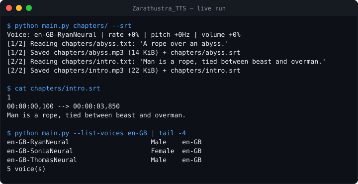
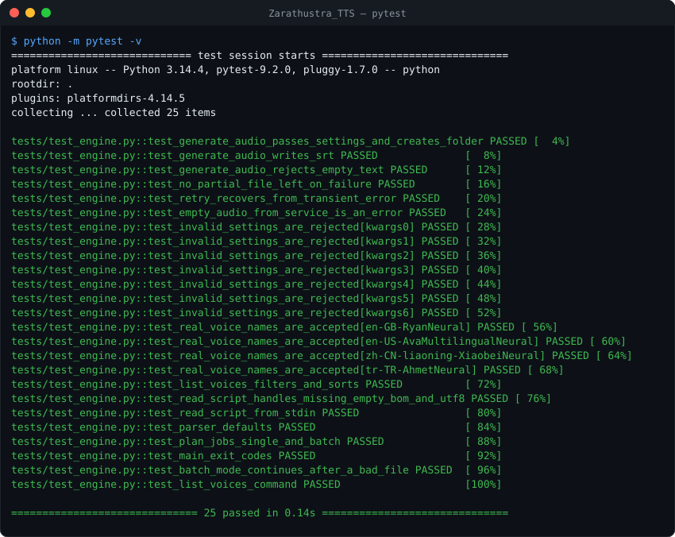
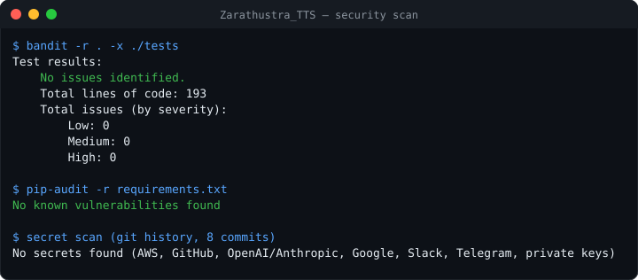

# Zarathustra | Voice Engine

> *"Man is a rope, tied between beast and overman - a rope over an abyss."* - F. Nietzsche

[](https://github.com/fas0ftware/Zarathustra_TTS/actions/workflows/ci.yml)


A text-to-speech engine that turns long scripts into narrated audio **and matching SRT subtitles**. Built on Microsoft Edge's neural voices (via [`edge-tts`](https://github.com/rany2/edge-tts)), no API key required, designed to be dropped into larger content pipelines.



## ◼ Features

- **Neural voices** – 400+ voices in 100+ locales; default persona `en-GB-RyanNeural` (academic, authoritative).
- **Subtitles** – `--srt` writes a sentence-timed `.srt` file next to every audio file (ready for video editors and YouTube).
- **Batch mode** – pass a folder and every `.txt` inside becomes its own `.mp3` (and `.srt`). One bad file does not stop the batch.
- **Pipes** – read the script from stdin with `-`.
- **Fine control** – voice, rate, pitch and volume, validated before any network call.
- **Resilient** – transient network/service failures are retried with exponential back-off; files are written atomically, so a failed run never leaves a broken half-written mp3.
- **Voice browser** – `--list-voices tr` lists every Turkish voice, `--list-voices` lists all of them.
- **Scriptable** – non-zero exit code on any failure; importable `VoiceEngine` class.

## ◼ Installation

```bash
git clone https://github.com/fas0ftware/Zarathustra_TTS.git
cd Zarathustra_TTS
python3 -m venv venv && source venv/bin/activate   # Windows: venv\Scripts\activate
pip install -r requirements.txt
```

Requires Python 3.10+ and an internet connection (Edge-TTS calls Microsoft's online voice service).

## ◼ Usage

```bash
python main.py                                  # script.txt -> narration.mp3
python main.py essay.txt -o audio/essay.mp3 --srt
python main.py chapters/ -o audio/ --srt        # batch: every .txt in chapters/
cat notes.txt | python main.py - -o notes.mp3   # from stdin
python main.py essay.txt --voice en-US-GuyNeural --rate "+10%" --pitch "-5Hz" --volume "-10%"
python main.py --list-voices en                 # browse voices
python main.py --help
```

| Option | Default | Meaning |
|---|---|---|
| `script` | `script.txt` | Text file, folder of `.txt` files, or `-` for stdin |
| `-o, --output` | `narration.mp3` | Output file (batch mode: output folder) |
| `--voice` | `en-GB-RyanNeural` | Any Edge-TTS voice name |
| `--rate` / `--pitch` / `--volume` | `+0%` / `+0Hz` / `+0%` | Prosody adjustments |
| `--srt` | off | Also write subtitles |
| `--retries` | `3` | Attempts per file on service errors |
| `--list-voices [LOCALE]` | – | List voices and exit |

### Using it as a module

```python
import asyncio
from voice_engine import VoiceEngine

engine = VoiceEngine(voice="en-GB-RyanNeural", rate="+0%", pitch="+0Hz")
result = asyncio.run(engine.generate_audio("Hello from Zarathustra.", "out/hello.mp3", "out/hello.srt"))
print(result.audio_file, result.audio_bytes)
```

`generate_audio` creates the output folder, returns a `Result`, raises `ValueError` for bad input and `RuntimeError` when the service keeps failing.

Example subtitle output ([`docs/sample.srt`](docs/sample.srt)):

```
1
00:00:00,100 --> 00:00:03,850
Man is a rope, tied between beast and overman.

2
00:00:03,800 --> 00:00:06,050
A rope over an abyss.
```

## ◼ Tests

The suite replaces Edge-TTS with an in-memory fake, so it runs offline in well under a second. It covers settings validation, retries, atomic writes, SRT output, batch mode, stdin input, BOM/UTF-8 handling and the CLI exit codes.

```bash
pip install -r requirements-dev.txt
python -m pytest -v
```



## ◼ Security

Every push runs [bandit](https://github.com/PyCQA/bandit) (static analysis) and [pip-audit](https://github.com/pypa/pip-audit) (known CVEs in dependencies) in CI. Latest local scan, including a secret scan of the full git history:



## ◼ Project structure

```
Zarathustra_TTS/
├── voice_engine.py      # VoiceEngine class, validation, retries, voice listing
├── main.py              # Command-line interface (single, batch, stdin)
├── script.txt           # Sample input text
├── tests/test_engine.py # Offline test suite
├── docs/                # README images, sample subtitle
└── .github/workflows/ci.yml
```

## ◼ Notes and limitations

- Edge-TTS is an unofficial client for Microsoft's online voices. The service can change or rate-limit access at any time.
- Generated audio is git-ignored (`*.mp3`). Keep private scripts under names other than `script.txt`.
- Subtitle timing is per sentence, as reported by the voice service.

## ◼ Changelog

- **2.0.0** – SRT subtitles, batch folders, stdin input, volume control, setting validation, retries with back-off, atomic writes, `--list-voices`, `--version`, pytest suite (25 tests), CI with security scanning.
- **1.0.0** – Single-file narration with voice/rate/pitch options.

## ◼ Roadmap

- [ ] Voice-over integration for the FA Software video montage pipeline (Prometheus)
- [ ] Per-paragraph voices (dialogue scripts)

---

Part of the **FA Software** projects. Licensed under the [MIT License](LICENSE).
